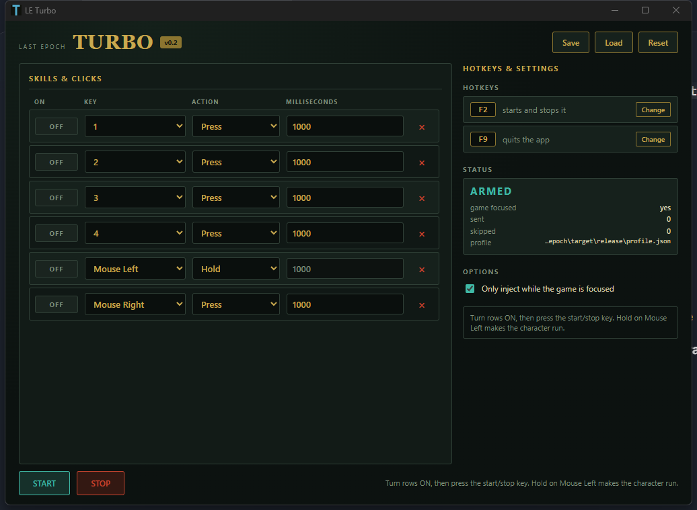
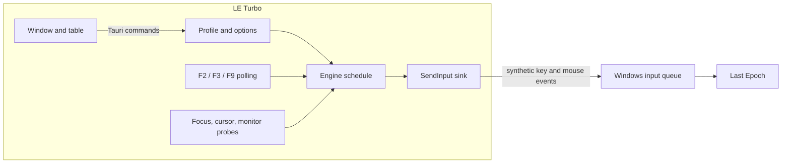
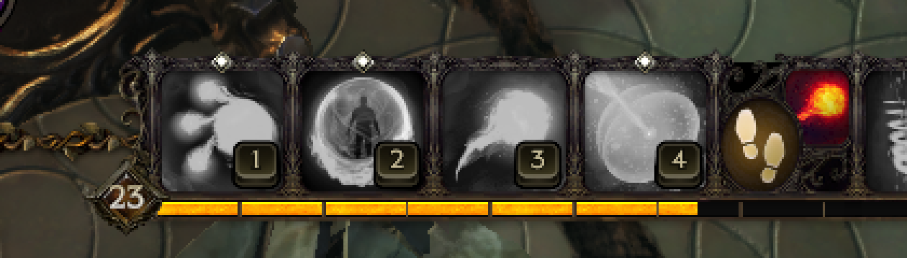

<div align="center">

# LE Turbo

### Presses your Last Epoch skills on a clock, holds the left button so your character runs, and never leaves a key stuck.




</div>

---

A tiny Rust + Tauri window that repeats key and mouse presses inside **Last Epoch**: five skill binds on a clock, a held left button for movement, and a focus gate so it can never type into the wrong application.

Built for one specific setup — skills remapped to `1` `2` `3` `4` and the **right mouse button**, with the **left button held to run** — but every row is editable, and each row chooses between a repeating tap or a held press.

---

## Why this exists

There is already a tool that does this for Diablo IV. It works, and it is worth copying: a small Rust + Tauri app that calls `SendInput` and presses keys on a timer. Two things about it shaped this project.

**It cannot know anything.** Its action is a timer, not a condition. It re-presses on a blind clock and hopes the buff lined up. Nothing in it reads the screen.

**It is easy to get wrong in a way that hurts.** A held mouse button that outlives its window leaves Windows dragging everything under the cursor until you click. That failure is worse than not having the tool.

So this project copies the mechanism, adds the honest safety rails the mechanism needs, and leaves the smarter version — refreshing a buff when it actually drops — as a planned second stage rather than a promise.

## Features

| Feature | What it does |
|---|---|
| **Press rows** | Tap a key or mouse button once per interval, repeating |
| **Hold rows** | Press down when armed, release when disarmed — this is how the left button drives movement |
| **Movement** | A `Mouse Left` `Hold` row is in the default profile; arm it and the character runs toward the cursor |
| **Focus gate** | Injection only happens while the game owns the foreground, matched on the **process name**, not the window title |
| **Cursor containment** | Mouse rows are skipped unless the cursor is inside the game window — a synthetic click lands on whatever is under the pointer, not on the focused window |
| **Guaranteed release** | Every held input is released on disarm, on quit, on focus loss, on profile change, and on unwind |
| **Hotkeys** | One key starts and stops the presser, another quits it, and **both are rebindable** — press Change, press any single key or mouse button, confirm |
| **Hotkey capture** | The app tells you which key it saw and waits for you to confirm it; modifiers and combos are refused, and the hotkeys stand down while recording |
| **Profiles** | Save, load and reset a JSON profile beside the executable |
| **Portable config** | `config.json` holds the expected process and window placement |
| **Pick your monitor** | The window opens on the monitor that is *not* running the game, and stays above it |
| **Screen-capture check** | Detects that the game's frame can be read and warns loudly when it cannot, because the planned buff detection depends on it |

## Download

From the [latest release](https://github.com/farukzahra/last-epoch/releases/latest) take either:

**Installer** — `LE-Turbo-setup.exe`. Installs for the current user only, so it never asks for administrator rights. It adds a Start Menu entry, and the finish page offers a **desktop shortcut** (ticked by default). Remove it later from Settings → Apps.

**Portable** — `le-turbo.exe`. No install step at all; drop it in a folder and run it. Keep it somewhere writable, because the app creates a `profiles\` folder and a `config.json` beside the executable.

Either way there is nothing else to install: it uses the WebView2 runtime that ships with Windows 10 and 11.

Rows start **disabled**. Turn one **ON**, then press the toggle key — `F2` until you change it in **Hotkeys & Settings**. Pressing it again stops the presser.

Neither binary is code-signed, so SmartScreen warns the first time: **More info** → **Run anyway**. The installer is built with NSIS and its source configuration is `tauri.conf.json` in this repository.

## Build from source

```powershell
git clone https://github.com/farukzahra/last-epoch.git
cd last-epoch
cargo build --release
```

The binary lands at `target\release\le-turbo.exe`.

To build the debug loop instead:

```powershell
cargo run
```

## How it works



Every few milliseconds the engine asks its probes three questions — *is the game focused, where is the cursor, where is the game window* — and presses the rows that are due. The only layer that touches Windows is a one-method trait, which is why the whole loop is unit tested against fakes with an injected clock.

Two design choices were forced by measurement rather than taste:

- **Hotkeys poll `GetAsyncKeyState` instead of using `RegisterHotKey`.** Windows never raises a registered hotkey for injected input, and a message pump can swallow `WM_HOTKEY` before a handler window sees it. Polling is focus-independent and observable from tests.
- **Mouse rows check the cursor.** Last Epoch does not clip the cursor to its window, and `SendInput` mouse events go to whatever window is under the pointer. Without the check, a `Mouse Right` row would click whatever you left the cursor over.

The full reverse-engineering write-up of the reference tool, and the measurements above, are in [`docs/reverse-engineering/d4turbo-analysis.md`](docs/reverse-engineering/d4turbo-analysis.md).

## Safety

The invariant this app takes seriously: **an input must never outlive the app.**

Release happens on every exit path — pressing `F3`, closing the window, pressing `F9`, the game losing the foreground while a button is held, and a profile change while a button is held. Rows ship **disabled**, so nothing runs until you arm it.

Injection is gated to the game's process, and mouse rows additionally require the cursor inside the game window. There is no process injection, no code hooking, no kernel driver, and no memory reading.

## Configuration

Two files sit next to the executable.

`config.json`:

```json
{
  "expected_process": "Last Epoch.exe",
  "open_on_other_monitor": true,
  "hotkeys": { "arm": "F2", "disarm": "F3", "quit": "F9" }
}
```

`profile.json`:

```json
{
  "version": 1,
  "rows": [
    { "id": 0, "key": "1", "action": "Press", "ms": 1000, "enabled": false },
    { "id": 5, "key": "Mouse Left", "action": "Hold", "ms": 1000, "enabled": false }
  ]
}
```

`action` is `Press` or `Hold`. `key` accepts `0`-`9`, `A`-`Z`, `F1`-`F24`, `Space`, `Tab`, `Enter`, `Esc`, and `Mouse Left` / `Mouse Right` / `Mouse Middle`. Intervals are clamped to a **10 ms** floor. The schema carries a version and reserves a `condition` field so a later release can add screen-based rows without invalidating existing profiles.

## The in-game target



## Roadmap

- **v1 — shipped.** Press and hold rows, focus gate, cursor containment, guaranteed release, profiles, hotkeys, capture check.
- **v2 — buff detection.** Refresh a buff when its icon actually leaves the screen instead of on a blind clock. The profile schema and the capture check are already in place; what is missing is which buff to watch and where its icon appears.
- **Later.** Rebindable hotkeys (the config already carries them), and a per-row "re-assert" period for games that drop synthetic held state.

## FAQ

<details>
<summary><b>Is this allowed? Will I get banned?</b></summary>

Automation can violate a game's terms of service. That risk is yours, and it is real for online play. The app deliberately uses the least invasive mechanism available — plain `SendInput` from a normal user-mode process — rather than memory reading or a driver, but that reduces detectability, it does not make it permitted.
</details>

<details>
<summary><b>Why does nothing happen when I press F2?</b></summary>

The focus gate is on by default and matches `Last Epoch.exe`. If the game is not the foreground window, the engine stays idle on purpose. The status panel shows whether the game is seen as focused, and `expected_process` in `config.json` can be corrected.
</details>

<details>
<summary><b>Why did my mouse row not fire?</b></summary>

Mouse rows require the cursor inside the game window. Synthetic mouse clicks are delivered to whatever is under the pointer, so a row firing while the cursor sits on another monitor would click that monitor's desktop. Keyboard rows are unaffected.
</details>

<details>
<summary><b>Why does it warn that it cannot read the game screen?</b></summary>

The capture check came back black, which is what exclusive fullscreen looks like. Switch the game to windowed or borderless. Nothing in v1 depends on it, but the planned buff detection does.
</details>

<details>
<summary><b>Where did the app icon come from?</b></summary>

`research/make_icon.py` generates a placeholder — a gold "T" on the app's dark green. Replace `icons/icon.ico` with real artwork and rebuild.
</details>

## Development

```powershell
cargo test          # 54 tests, no Windows API calls: pure logic against fakes
cargo build --release
```

The split that makes that possible: key parsing, the profile model, scheduling, the safety predicates and held-input bookkeeping are pure modules with unit tests; every Win32 call sits behind a one-method trait (`RawSender`, `GameProbe`). The engine loop is tested with a fake sink, a fake probe and an injected clock — including the tests that pin the release-on-focus-loss and cursor-containment guarantees.

The design document and the implementation plan live in [`docs/superpowers/`](docs/superpowers/), and the throwaway Python prototype that validated `SendInput` against the real game is in [`spike/`](spike/README.md).

## License

[MIT](LICENSE).

Automation in an online game may violate its terms of service. Use it on software you own or are authorised to automate, and prefer offline play.
