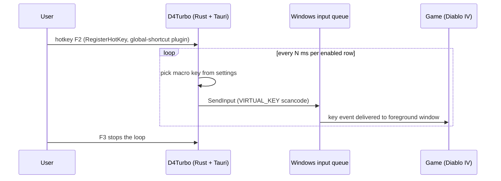

# Reverse engineering: D4Turbo (Diablo IV macro tool)

**Target:** `C:\Program Files\D4Turbo\D4Turbo.exe`
**SHA-256:** `CE0ED135C8F9D2DB4E0E4B3325384C3844656D5F6105B816614994034038C4E7`
**Size:** 13,249,536 bytes · x86-64 GUI · version 2.3.0 · author `Raiden152` · built 2026-09-24
**Analyst:** agent (opencode) on 2026-10-12 — static analysis (PE, imports, strings, crate list) + runtime observation (window enumeration, UI, persisted settings).

## 1. Answer to the core question: how does it send input to the game?

> **It emulates a real keyboard/mouse at the Windows OS level with `SendInput`.**
> It does **not** send any custom "command" into the game process, does **not** inject code, does **not** use a driver, and does **not** hook the game.

The game simply receives normal-looking key/mouse events, exactly as if you pressed the key yourself. There is no game-specific protocol involved — which is why the same tool architecture works for any game that accepts synthetic OS input.

### Evidence

| Evidence | Finding |
|---|---|
| Import table | `user32!SendInput`, `SetCursorPos`, `GetCursorPos`, `PostMessageW`, `SendMessageW`, `GetAsyncKeyState`, `MapVirtualKeyW`, `FindWindowW`, `SetForegroundWindow`, `RegisterRawInputDevices`, `GetRawInputData` |
| DLL internals leaked in strings | `enigo-0.6.1\src\win\win_impl.rs`, `enigo::platform::win_impl`, `enigo::keycodes` |
| `enigo` 0.6.1 | Cross-platform Rust input-simulation crate. **On Windows its backend is `SendInput`.** Keycode table present (`LButton/RButton/MButton/XButton1/XButton2`, `Num0..Num9`, `F1..F24`, …) → keyboard **and** mouse buttons |
| Absent | `OpenProcess`, `VirtualAllocEx`, `WriteProcessMemory`, `CreateRemoteThread` (no injection) · `SetWindowsHookEx` (no hooks) · `Interception`, `ViGEm`, `vJoy`, `HID` (no virtual device driver) · `xinput*.dll`, `dinput8.dll` (no gamepad emulation) |
| Absent | any capture/OCR crate (`xcap`, `screenshots`, `image`, `tesseract`, `windows-capture`) → **no vision at all** |
| `BitBlt` / `CreateDIBSection` / `DwmEnableBlurBehindWindow` | come from `softbuffer` + window-effects, i.e. drawing the app's own acrylic window — **not** screen reading |

### Diagram



## 2. What the tool actually is (stack)

- **Rust + Tauri 2.11.0** desktop app. GUI is a **WebView2** page (`EmbeddedBrowserWebView.dll`, `tauri://localhost`), not a native/ImGui UI.
- Crates seen: `tauri` 2.11.0, `tao` 0.35.0, `wry` 0.55.0, `enigo` 0.6.1, `tokio` 1.52.1, `reqwest` 0.12.28 (+ `hyper`, `schannel`), `rand` 0.10.1, `regex`, `semver`, `softbuffer` 0.4.8, `muda` 0.19.1, `rfd` 0.16.0.
- Tauri plugins: **`global-shortcut` 2.3.1**, `dialog`, `fs`, `opener`, `single-instance` 2.4.2.
- Runtime footprint (window enumeration): main window class **`Tauri Window`**, title `D4Turbo`; hidden single-instance window class `com.raiden152.d4turbo-sic`; `Tao Thread Event Target`.
- Not an overlay: the main window is a normal window (no `WS_EX_TOPMOST`, no `WS_EX_TRANSPARENT`). It is not drawn inside the game.
- Networking exists (`reqwest`/`schannel`) and the update check uses `https://sourceforge.net/projects/d4turbo/rss?path=/`; `semver` + a `check_latest_version` command compare versions. `rand` is present (jittered timing / values).
- Tauri IPC commands recovered from strings: `update_macros`, `update_wheel_bindings`, `update_shortcuts`, `set_shortcuts_enabled`, `save_settings`, `load_settings`, `delete_settings`, `config`, `check_latest_version`, plus the `global-shortcut` register/unregister API.

## 3. Feature model (from the UI and the persisted schema)

UI columns: **KEY | SKILL | ACTION | MILLISECONDS**, plus a Settings panel with Hotkeys / Mouse Wheel / Keybinding / Links.

Persisted profile (`%APPDATA%\<id>\settings.d4t`, JSON):

```json
{
  "profileName": "barb",
  "profileDir": "C:\\Users\\<user>\\OneDrive\\Documentos",
  "macros": [
    { "key": "1",           "icon": "data:image/svg+xml,...", "action": "Timer",    "ms": 5000 },
    { "key": "2",           "icon": "data:image/svg+xml,...", "action": "Timer",    "ms": 3000 },
    { "key": "Mouse Left",  "icon": "...",                    "action": "Select...","ms": 1000 },
    { "key": "Q",           "icon": "...",                    "action": "Select...","ms": 1000 },
    { "key": "SPACE",       "icon": "...",                    "action": "Select...","ms": 1000 }
  ],
  "shortcuts": [
    { "id": "start", "key": "F2", "description": "to Start Auto" },
    { "id": "stop",  "key": "F3", "description": "to Stop Auto" },
    { "id": "quit",  "key": "F9", "description": "to Quit Application" }
  ]
}
```

Rust structs recovered from the binary: `MacroBinding` (4 fields), `WheelBindingConfig` (2 fields → `wheelUpKey`, `wheelDownKey`), `ShortcutBinding` (3 fields → `id`, `key`, `description`).

**Model:** a list of `(key, action, interval_ms)` rows. Turning "Auto" on repeats each enabled row's `key` every `interval_ms` while the game is focused. Global hotkeys start/stop/quit (`F2`/`F3`/`F9`). A separate feature remaps **mouse wheel up/down to keys**. Profiles are named and saved (`barb`, …).

**Crucially: `action` is a *timer*, not a condition.** There is no feedback from the game — no screen reading, no detection. The user's own profile spams `1` every 5000 ms and `2/3/4` every 3000 ms. It re-presses on a fixed clock and hopes the buff/cooldown lined up.

## 4. Options for delivering input (what we can choose for Last Epoch)

| Method | How | Pros | Cons |
|---|---|---|---|
| **`SendInput`** (what D4Turbo does) | `user32!SendInput` with `INPUT_KEYBOARD`/`INPUT_MOUSE` | Simple, user-mode, no admin, works with most Unity titles, foreground target | Ignored by games that read only **Raw Input**; must not be typed while the user types in another app unless you gate on the target window |
| `PostMessageW` / `SendMessageW` | Post `WM_KEYDOWN`/`WM_KEYUP` to the game window | Can work in the **background** (no focus steal) | Many Unity/IL2CPP titles ignore synthesized window messages; fragile |
| **Virtual HID driver** (Interception / ViGEm) | Kernel driver creates a *real* virtual keyboard/controller | Indistinguishable from hardware; works with Raw Input-only games | Kernel driver install, admin, signing, malware-heuristics, game ToS risk |

Recommendation: **start with `SendInput`** (same as the reference tool), add a window-target gate (only inject while Last Epoch is the foreground window), and keep `PostMessage`/virtual-HID as fallbacks if Last Epoch ignores synthetic input.

## 5. The gap for "auto-buff when the buff ends"

D4Turbo cannot do this — it has no way to know a buff ended. For Last Epoch we need a feedback signal. Options, cheapest → most invasive:

1. **Timer + adaptive** — re-cast on a fixed interval with jitter. No detection. Zero risk, zero setup, but wrong when the buff is refreshed early/late.
2. **Screen vision (recommended)** — capture a small ROI of the buff bar and detect the icon's presence / alpha / colour / a cooldown wipe. Pure image math (template match or pixel-ratio), no OCR needed if you only need present/absent. Needs a stable UI layout and works with windowed/borderless.
3. **Game log / chat combat log** — if Last Epoch emits buff apply/expire lines to `Player.log`, react to events. Cheapest "smart" option *if the data exists* — needs verification.
4. **Memory reading (IL2CPP)** — read buff timers from process memory. Extremely precise but offsets break every patch and this is the most ToS-hostile and anti-cheat-visible route. Not recommended.

Recommended v1 → v2 path: ship (1) first (a working D4Turbo-equivalent for Last Epoch), then add (2) for auto-buff, using (3) only if logs prove useful.

## 6. Legal / ToS note

Reverse engineering a tool you already own for interoperability/learning is what REA's disclaimer covers. But using automation in an online game can violate the game's EULA/ToS and, for online/competitive modes, risk the account. Prefer **offline/SSF (solo self-found)** play. This is a decision for the user, not something the agent should decide.

## 7. Reproducing this analysis

```powershell
python research/pe_report.py  "C:\Program Files\D4Turbo\D4Turbo.exe"   # headers, sections, imports
python research/strings.py    "C:\Program Files\D4Turbo\D4Turbo.exe"   # keyworded strings
python research/capture_ui.ps1                                          # enumerate windows + screenshot
```
Artifacts: `research/d4turbo_pe_utf8.txt`, `research/d4turbo_strings.txt`, `research/d4turbo_allstrings.txt`.

## 8. Validated on Last Epoch (spike results)

The mechanism was confirmed end-to-end against the real game before writing any
product code. Details and test scripts: `spike/README.md`.

| Claim | Result |
|---|---|
| `SendInput` reaches Last Epoch | **Confirmed.** Pressing `1` while the game was foreground changed 13.6% (VK) / 16.9% (scancode) of the skill-bar pixels; a no-input control run measured **0.00%** |
| Screen capture works | **Confirmed.** `CopyFromScreen` / `BitBlt` return real pixels — the game is not exclusive fullscreen. This is what makes pixel-based buff detection viable |
| `RegisterHotKey` is usable | **Rejected.** It registers, but Windows never fires it for injected input, and Tk's message pump swallows `WM_HOTKEY`. Switched to polling `GetAsyncKeyState` (verified PASS) |
| A normal window stays visible over the game | **Rejected.** Without `HWND_TOPMOST`, `WindowFromPoint` returned the game for every point inside our own window |

Chosen approach for the Last Epoch tool: `SendInput` for output, `GetAsyncKeyState`
polling for hotkeys, `HWND_TOPMOST` + explicit monitor placement for the window.

